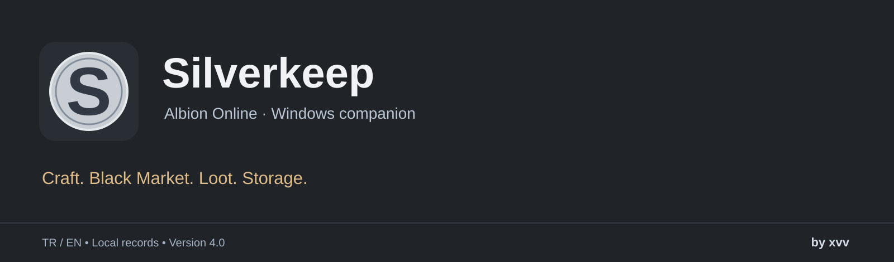
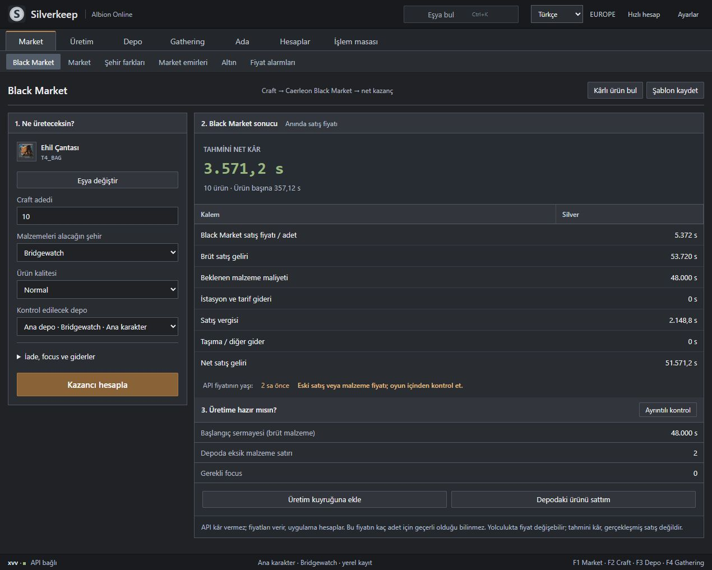
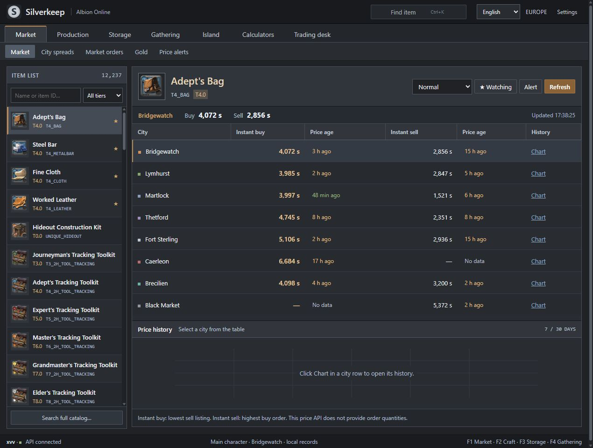

<p align="center"></p>

# Silverkeep

**A Windows desktop economy companion for Albion Online.** Crafting to the Caerleon Black Market, bulk loot offers, local storage and actual profit tracking. Turkish / English, local records.

**By xvv · [iflaholmaz](https://github.com/iflaholmaz)**

[**Download the Windows installer**](https://github.com/iflaholmaz/silverkeep/releases/latest/download/Silverkeep-Kurulum.exe) · [Releases](https://github.com/iflaholmaz/silverkeep/releases) · [Türkçe](README.md) · [Quickstart](docs/QUICKSTART.en.md)

Download `Silverkeep-Kurulum.exe`, run it and click **Kur ve aç**. Setup creates a desktop shortcut and preserves existing records during updates.

## Simple Black Market workflow

Select the item, craft batches and material city. Calculate estimated net profit after materials, tax, station and transport costs. Return rate, focus and costs are in an expandable section; stale prices are marked.



## Features

- Regional market prices, city comparison, quality, price history, alerts and gold.
- Crafting/refining, route scanning, enchant and alternative production paths.
- Bulk loot valuation, purchase percentages, saved price snapshots and party splits.
- Multiple storage containers, weighted book cost, transfers, CSV and held-stock tracking.
- Stock sales linked to actual revenue, costs and profit records.
- Undo and corrections that retain the original record and check newer dependencies.
- Calculator templates, preflight checks, equipment carts and personal goals.
- Gathering sessions, island production, Windows timers and manual Avalon maps.
- A separate quick calculator with an always-on-top option.



## Data and limits

Prices come from the [Albion Online Data Project](https://www.albion-online-data.com/api/) and are timestamped. Order quantities and execution are not guaranteed. The app calculates profit from prices and your assumptions; it does not receive profit from the API. Black Market uses its buy order price for instant selling and is separate from the normal Caerleon market.

Storage, orders, gathering and routes are recorded locally. The app does not read your personal game account or automate game actions. Do not record the same linked sale costs again manually. Undo records begin with version 4.0. Timers require the app to be running.

Compatibility data path: `%APPDATA%\AlbionDesk`. Install path: `%LOCALAPPDATA%\Programs\AlbionDesk`. Backups and JSON import/export are available. Uninstalling preserves records. No personal records or API cache are included in this repository.

## Development

Node.js 22+, Windows and the .NET Framework C# compiler are required.

```powershell
npm install
npm start
npm test
npm run build
```

Item data is generated from the pinned public `ao-data/ao-bin-dumps` revision on first use. The build script downloads the official Electron Windows x64 runtime, verifies SHA-256 and produces `dist/Silverkeep-Kurulum.exe`.

Source and logo by **xvv**. No open-source license has been assigned to the application source. Third-party rights remain with their owners; see [THIRD_PARTY.md](THIRD_PARTY.md). This is an independent application, not affiliated with or endorsed by Sandbox Interactive.
