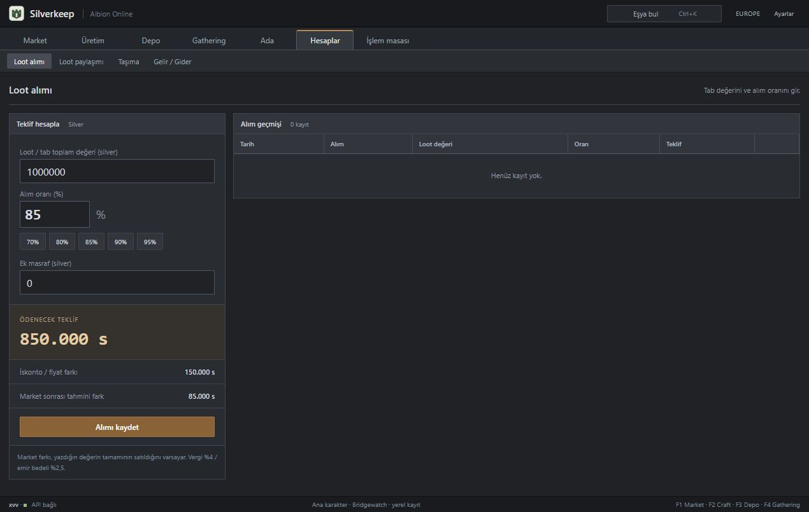

<p align="center"></p>

# Silverkeep

**Albion Online için Windows masaüstü ekonomi uygulaması.** Craft üretiminden Caerleon Black Market satışına, toplu loot tekliflerinden depo ve gerçekleşmiş kâr takibine kadar tek yerde. Türkçe / English; kayıtlar bilgisayarında saklanır.

**Geliştirici: xvv · [iflaholmaz](https://github.com/iflaholmaz)**

[**Windows kurulum EXE’sini indir**](https://github.com/iflaholmaz/silverkeep/releases/latest/download/Silverkeep-Kurulum.exe) · [Sürümler](https://github.com/iflaholmaz/silverkeep/releases) · [English](README.en.md) · [Kullanım rehberi](docs/KULLANIM.md)

## Kurulum

1. `Silverkeep-Kurulum.exe` dosyasını indir.
2. Çalıştır ve **Kur ve aç** düğmesine bas.
3. Masaüstündeki **Silverkeep** kısayoluyla kullan.

Güncelleme mevcut kayıtları korur. Pencereyi kapatmak uygulamayı tepsiye küçültür; tamamen kapatmak için tepsi menüsünü kullan. Küçük hesap penceresi üst sağdaki **Hızlı hesap** düğmesindedir.

## Black Market, daha basit

Uygulama doğrudan Black Market ekranıyla açılır. Eşyayı, craft adedini ve malzeme şehrini seç; **Kazancı hesapla** düğmesi malzeme, vergi, istasyon ve taşıma giderleri sonrası tahmini net kârı gösterir. İade/focus/giderler ayrı açılır bölümde; eski fiyatlar işaretlenir.


## Neler var?

| Alan | Özellikler |
|---|---|
| Market | Şehir fiyatları, kalite, 7/30 günlük geçmiş, alarmlar, altın |
| Üretim | Craft/refining, kârlı rota taraması, alternatif üretim yolları, enchant |
| Black Market | Anında satış fiyatıyla net kâr, üretim kuyruğu, malzeme/sermaye/focus kontrolü |
| Loot | Çok eşyalı API değerlemesi, yüzde teklif, fiyatı kaydedilmiş tablar, parti paylaşımı |
| Depo | Çoklu şehir/karakter/sandık, ağırlıklı maliyet, transfer, CSV, bekleyen stok |
| Gerçek satış | Stok düşümü, bağlı gelir/maliyet kayıtları, gerçekleşmiş kâr |
| Geçmiş | Bağlı işlemlerle geri alma, adet/fiyat düzeltme, eski kaydı koruyan ters hareketler |
| Planlama | Hesap şablonları, ekipman sepeti, üretim öncesi kontrol, kişisel hedefler |
| Gathering / ada | Oturumlar, kaynak raporu, üretim döngüleri, Windows sayaç bildirimleri |
| Avalon | Elle girilen portal bağlantıları, süreler, notlar ve görsel rota haritası |

### Türkçe / English

Üst sağdaki dil seçimi yeniden açılışta korunur. Eşya adları, menüler, formlar, sayı/tarih biçimleri ve tepsi menüsü seçilen dili kullanır. Kendi yazdığın kayıt adları korunur.


### Loot teklifi

Loot değerini ve alım yüzdesini gir; varsayılan **%85**. Örneğin 1.000.000 silver değerindeki loot için teklif 850.000 silver olur. Toplu loot ekranında eşyaların adet/kalitesiyle toplam API değerlemesi de yapılır.



## Veri ve hesapların sınırları

- Fiyatlar [Albion Online Data Project](https://www.albion-online-data.com/api/) topluluk verisidir. Fiyatın yaşı gösterilir; emir miktarı veya gerçekleşme garantisi yoktur.
- **Black Market** ve normal **Caerleon marketi** farklı fiyat yerleridir. Black Market hesabı anında satış için alış emri fiyatını kullanır.
- Kâr, uygulamanın fiyatlar ve girdiğin giderlerle yaptığı hesaptır. İade oranı ortalama tüketimdir; hedef kalite garanti edilmez.
- Depo, kişisel emirler, gathering ve rotalar oyun hesabından otomatik okunmaz. Oyun işlemleri otomatik yapılmaz.
- Gerçek satış gelir ve maliyeti deftere bağlanır. Aynı satışı veya maliyetini manuel tekrar yazma.
- Geri alma, 4.0’dan itibaren kaydedilmiş işlemler içindir. Aynı kaydı etkileyen daha yeni hareket varsa önce onu geri al.
- Sayaç bildirimleri için uygulama çalışmalı. Uyku/kapalı bilgisayarda bildirim gelmez; gecikmiş sayaçlar yeniden açılışta kontrol edilir.

## Yerel kayıtlar

Uyumluluk için kayıtlar `%APPDATA%\AlbionDesk` altında; kurulum `%LOCALAPPDATA%\Programs\AlbionDesk` içindedir. Görünen ad ve EXE **Silverkeep**’tir. JSON dışa/içe aktarma, önceki sağlam kayıt ve son 30 günlük yedekler bulunur. Kaldırmak takip kayıtlarını silmez.

Bu depoda kişisel kayıtlar, oyun hesabı bilgileri ve API önbelleği bulunmaz.

## Kaynaktan çalıştırma

Node.js 22+ ve Windows gerekir. Electron sürümü sabittir.

```powershell
npm install
npm start
npm test
npm run build
```

İlk çalıştırma oyun eşya/tarif verilerini `ao-data/ao-bin-dumps` kaynağından indirip `src/data/` altında üretir. `npm run data` veriyi yeniden üretir. `npm run build`, resmî Electron Windows x64 paketini SHA-256 kontrolüyle indirir ve `dist/Silverkeep-Kurulum.exe` oluşturur. Windows .NET Framework C# derleyicisi gerekir.

## Kaynaklar ve haklar

Uygulama ve logo: **xvv**. Oyun verileri/görselleri Albion Online ve ilgili sahiplerine; Electron kendi lisansına tabidir. Üçüncü taraf kaynaklar [THIRD_PARTY.md](THIRD_PARTY.md) dosyasındadır. Kaynak kod için ayrıca bir açık kaynak lisansı atanmadı.

Silverkeep bağımsız bir yardımcı uygulamadır; Sandbox Interactive ile bağlantılı veya onun tarafından onaylanmış değildir.
